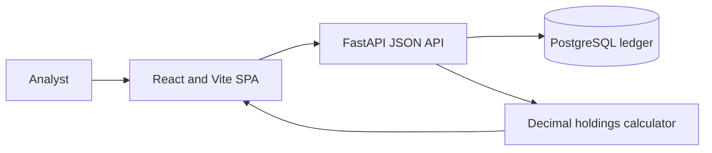

# 📈 FinTrack: A clear portfolio ledger for investment analysts

**FinTrack is a production-grade portfolio-tracking assessment project that bridges the gap between recorded investment trades and an explainable holdings summary.**

## 🎯 Project Goal

Give an investment analyst a small, understandable workflow from login to portfolio management, trade recording, and a verified holdings summary. All account and portfolio data in the demo are fictional.

## 🧬 System Architecture

1. **React and Vite** provide the responsive browser interface.
2. **FastAPI and Pydantic** validate authenticated portfolio and trade requests.
3. **SQLAlchemy and PostgreSQL** persist owner-scoped portfolios and an ordered transaction ledger.
4. **Decimal ledger replay** derives open positions, remaining cost basis, and estimated value from recorded trades.

## 🛠️ Technical Stack

| Layer | Tool | Version |
|:--|:--|:--|
| API | FastAPI, Pydantic, SQLAlchemy | Locked in `backend/pyproject.toml` |
| Database | PostgreSQL | 16 |
| Web | React, Vite, TypeScript | Locked in `frontend/package-lock.json` |
| API checks | pytest, HTTPX, Ruff | Locked in `backend/uv.lock` |
| UI checks | Vitest, React Testing Library | Locked in `frontend/package-lock.json` |

## 📊 Performance & Results

Verification results, clean-install time, and the final worked-ledger values will be recorded here after the checks run. FinTrack does not claim live market prices or investment advice.

## 📸 Screenshots

Actual desktop portfolio list/detail and mobile detail screenshots will be added under `docs/screenshots/` after browser verification.

## 🧾 Ledger Assumptions

| Metric | Definition |
|:--|:--|
| Total invested | Remaining weighted-average cost basis of open units |
| Estimated value | Open units multiplied by the latest recorded trade price for that instrument |
| Price/currency scope | Trades use the portfolio currency; no FX, fees, taxes, market feed, or realized gains |

## 🧠 Key Design Decisions

- **Ledger is the source of holdings:** one backend Decimal service replays transactions and validates every proposed mutation.
- **Prices are estimates:** the latest recorded trade price is used so the calculation stays explicit and reproducible.
- **Authentication is short-lived:** the browser keeps the one-hour bearer token in memory; a refresh requires signing in again.
- **Ownership is enforced on the server:** the authenticated analyst scopes every portfolio and trade operation.

## 📂 Project Structure

The complete, checked tree will be listed after implementation so generated and ignored files are identified accurately.

## ⚙️ Installation & Setup

See the verified local setup commands and public service URLs below after the clean-install and deployment checks. Copy `.env.example` to `.env` and replace local-only placeholders before starting services.

## 🔌 API and Verification

The API contract, migration and seed commands, lint/test/build commands, and exported OpenAPI schema will be documented after verification. Swagger is served at `/docs` when the API runs.

## 🎓 Skills Demonstrated

- **API development:** authentication, request validation, ownership checks, and consistent errors.
- **Financial calculations:** Decimal ledger replay, weighted-average basis, and mutation rollback.
- **Frontend engineering:** accessible responsive forms, request states, sorting, filtering, and an API-backed allocation view.
- **Engineering workflow:** migrations, lockfiles, focused tests, review evidence, and deployment verification.

## 🤖 AI Assistance

OpenAI Codex assisted with planning, implementation, and verification. Ian owns the assessment decisions and final submission.
