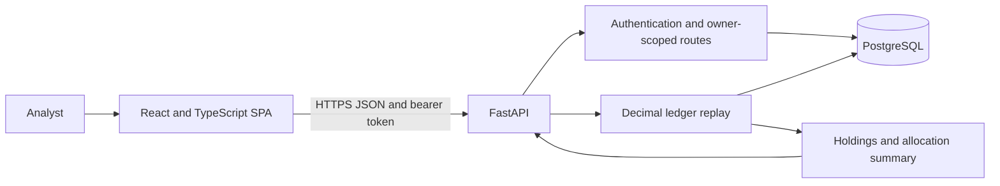
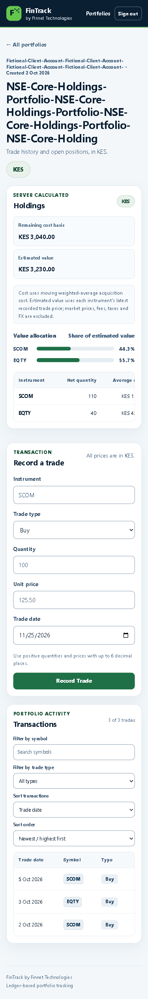

# 📊 FinTrack: Ledger-Based Portfolio Tracker

**FinTrack by Finnet Technologies** is an assessment prototype built with production-minded practices to bridge the gap between an ordered trade ledger and an analyst-facing holdings view. It records fictional trades and derives open positions, moving weighted-average cost, allocations, and estimated value from transaction history. It does not provide investment advice or live market prices.

**Live evaluator demo:** [FinTrack](https://fintrack-lyart-eight-61.vercel.app)

**API:** [https://fintrack-api-bs43.onrender.com](https://fintrack-api-bs43.onrender.com) · **Swagger:** [OpenAPI UI](https://fintrack-api-bs43.onrender.com/docs) · **OpenAPI JSON:** [Schema](https://fintrack-api-bs43.onrender.com/openapi.json)

The public seed account is fictional. The demo username is `demo`; its password is supplied privately for evaluation.

## 🎯 Project Goal

I built FinTrack to give an analyst a verifiable path from account creation through portfolio setup, trade entry, and a holdings summary. Each portfolio has one owner and one base currency. The API owns accounting calculations; the browser presents the returned values and lets the analyst inspect the underlying ledger.

## 🧬 System Architecture

1. **React SPA** handles account access, portfolio management, trade entry, holdings, and transaction history.
2. **FastAPI** authenticates analysts, validates requests, applies owner-scoped access, and exposes JSON and OpenAPI.
3. **PostgreSQL** stores analysts, portfolios, and ordered trades; SQLAlchemy and Alembic manage persistence and schema changes.
4. **Decimal ledger service** replays trades in deterministic order and returns positions, portfolio totals, and allocation percentages.



## 🛠️ Technical Stack

| Layer | Tool | Version | Purpose |
|:--|:--|:--|:--|
| **Frontend** | React | 19.3.1 | Analyst workspace |
| **Frontend** | TypeScript | 5.9.3 | Typed UI and API contracts |
| **Frontend** | Vite | 8.3.8 | Local development and production bundling |
| **Routing** | React Router | 7.18.6 | Protected pages and deep links |
| **Runtime** | Node.js / npm | 22.23.5 / 11.17.0 | Locked frontend install and scripts |
| **Backend** | Python | 3.12 (3.12.14 measured) | API runtime |
| **Backend** | FastAPI / Pydantic | 0.165.0 / 2.14.4 | HTTP API and input validation |
| **Persistence** | PostgreSQL | 16 (Alpine image) | Relational storage and row locking |
| **Persistence** | SQLAlchemy / Alembic | 2.1.9 / 1.20.1 | Data access and migrations |
| **Authentication** | PyJWT / pwdlib | 2.15.1 / 0.4.2 | HS256 tokens and Argon2id password hashes |
| **Verification** | pytest / Ruff | 8.4.2 / 0.17.6 | Backend tests and lint |
| **Verification** | Vitest / React Testing Library | 5.1.1 / 16.3.3 | Frontend tests |
| **Verification** | ESLint / TypeScript | 10.15.0 / 5.9.3 | Frontend lint and type checking |

Frontend versions are from `frontend/package-lock.json`; Python package versions are from `backend/uv.lock`.

## 📊 Performance & Results

- Frontend at `bd4eff5`: **28 tests across 8 files** passed; ESLint and the production TypeScript/Vite build passed (33 modules; 296.18 kB JavaScript, 91.12 kB gzip).
- Portfolio detail regression tests prove an older save refresh cannot restore a deleted ledger row, a late delete cannot steal focus from another portfolio, a save completing after navigation cannot publish success in the new portfolio, and a failed refresh cannot announce refreshed totals. Route changes also clear stale pending state.
- Backend at `bd4eff5`: **52 tests passed** against a separate disposable PostgreSQL database on port 55485; Ruff and the OpenAPI export check also passed.
- At a 375px document client width, captured with a 390px Playwright window and a stable 15px scrollbar gutter, both list and detail document widths measured **375/375px** (`clientWidth` / `scrollWidth`) with 100-character portfolio and client names. On the list, the name/client block measured x=32.8–342.4; Open, Edit, and Delete ended at x=149.2, 206.6, and 280.0. On detail, title/client content measured x=16–359.2, the KES badge ended at x=76.8, and Record Trade ended at x=341.4.
- `docs/openapi.json` matches the FastAPI schema; the trade quantity and unit price use decimal-string inputs and a valid request example.
- Test database isolation rejects the application database before engine creation or DDL; the focused guard test passed. Integration tests used only the disposable database on port 55485, never the running preview database on port 55432.
- In a clean worktree at `bd4eff5`, `npm ci`, `uv sync --locked`, migration, and seed took **17.34 seconds** with warm npm/uv caches. It used Python 3.12.14, uv 0.12.9, Node 22.23.5, npm 11.17.0, and PostgreSQL 16.16. Docker Desktop was unavailable; the disposable database was already provisioned and running on port 55485, so database provisioning, process startup, and cold dependency downloads are excluded. Full cold setup remains unverified.
- No load or performance benchmark has been run.

## 📸 Application Screenshots

The screenshots show fictional local sample data from an isolated browser review. They do not represent a hosted demo or live market prices.

**Desktop portfolio list.** Fictional portfolio cards show portfolio names, client names, creation dates, currencies, and list actions.


**Desktop portfolio detail.** Holdings and the valuation assumption appear above trade entry and transaction history.


**375px document-width mobile portfolio detail.** Captured at 390px browser width with a stable 15px scrollbar gutter. The 100-character portfolio and client names wrap, the document measures 375/375px, and Record Trade ends at x=341.4.



## 📈 Domain Coverage

| Domain item | FinTrack behavior |
|:--|:--|
| Instruments | Fictional sample trades use NSE symbols such as SCOM, EQTY, and KCB; no market feed is connected. |
| Base currencies | Each portfolio uses KES or USD; portfolios are not converted between currencies. |
| Trade types | BUY adds units and cost basis; SELL reduces open units and basis. |
| Ledger ordering | Trades replay by trade date, creation time, and stable transaction ID. |
| Valuation | Estimated value uses the latest recorded trade price times open units. |
| Allocation | Percentages use unrounded Decimal position values before display rounding. |

## 🧠 Key Design Decisions

- **Server-owned accounting:** I keep accounting and allocation calculations in the API so the browser cannot drift from ledger rules.
- **Numeric precision:** I use Decimal inputs and database numeric columns for financial values, and serialize monetary values as decimal strings.
- **Trade integrity:** I lock the owned portfolio while validating and writing trade changes; the transaction rolls back when a later trade becomes invalid.
- **Async route state:** I scope detail results to the current portfolio route and request generation so stale responses cannot replace newer visible state.
- **Visual hierarchy:** I use a navy header, a restrained green brand mark and action color, neutral Buy/Sell labels, destructive red for delete actions, visible focus styles, and a holdings-first detail layout. Green and red financial change colors are reserved for signed amounts.
- **Authentication:** I keep session tokens in memory. A page reload requires sign-in again; refresh-token storage and additional analyst roles are outside the assessment scope.

## 📂 Project Structure

```text
.
├── backend/                 # FastAPI service and ledger domain
│   ├── app/                  # FastAPI routes, authentication, models, and ledger service
│   ├── migrations/           # Alembic schema revisions
│   ├── tests/                # API, database-safety, and accounting tests
│   ├── pyproject.toml        # Python requirements and tool configuration
│   └── uv.lock               # Locked Python dependency versions
├── docs/                    # API schema and visual evidence
│   ├── openapi.json          # Exported API schema
│   └── screenshots/          # Desktop and 375px browser evidence
├── frontend/                # React analyst workspace
│   ├── src/                  # React pages, components, API client, and tests
│   ├── package.json          # Frontend scripts and dependency ranges
│   ├── package-lock.json     # Locked JavaScript dependency versions
│   └── .nvmrc                # Node.js version
├── compose.yaml              # Local application and disposable test databases
├── .env.example              # Placeholder-only local configuration
├── .gitignore                # Excludes local secrets and projectsummary.md
└── README.md                 # Project documentation
```

`projectsummary.md` is a local, gitignored working note and is not part of the public repository.

## ⚙️ Setup and Local URLs

### Prerequisites

- Python 3.12 and `uv` 0.12.x or compatible locked-dependency support.
- Node.js 22.23.5 and npm 11.x (`frontend/.nvmrc` records Node).
- Docker Desktop with Docker Compose and PostgreSQL 16 images for local database provisioning.

### Start a local review environment

1. From the repository root, copy `.env.example` to `.env`, then replace the local placeholders. Keep every `TEST_DATABASE_URL` occurrence aligned with the `POSTGRES_USER` and `POSTGRES_PASSWORD` values used by Compose. Set `JWT_SECRET_KEY` to a private unpredictable value of at least 32 characters and set a private fictional `DEMO_PASSWORD`. Do not commit `.env`.
2. Start the application database and the isolated test database:

   ```powershell
   docker compose up -d db test-db
   ```

3. Install backend dependencies, apply migrations, seed the fictional account, and start the API:

   ```powershell
   Set-Location backend
   uv sync --locked
   uv run --locked alembic upgrade head
   uv run --locked python -m app.seed
   uv run --locked uvicorn app.main:app --host 127.0.0.1 --port 8000
   ```

4. In a second terminal at the repository root, install the locked frontend dependencies and start Vite:

   ```powershell
   Set-Location frontend
   npm ci
   npm run dev
   ```

5. Sign in with the fictional `DEMO_USERNAME` and `DEMO_PASSWORD` configured in the private `.env` file.

| Local service | URL |
|:--|:--|
| Frontend | http://localhost:5173 |
| API | http://localhost:8000 |
| Swagger UI | http://localhost:8000/docs |
| OpenAPI JSON | http://localhost:8000/openapi.json |

### Hosted deployment

| Service | Public URL | Hosting configuration |
|:--|:--|:--|
| Frontend | [FinTrack](https://fintrack-lyart-eight-61.vercel.app) | Vercel Hobby; Vite project root `frontend`; `npm ci`, `npm run build`, output `dist`; `frontend/vercel.json` routes deep links to the app shell. |
| API | [FastAPI](https://fintrack-api-bs43.onrender.com) | Render Free web service in Virginia; Python 3.12; root `backend`; `uv sync --locked --no-dev`; start with `uv run --no-sync uvicorn app.main:app --host 0.0.0.0 --port $PORT`. |
| API docs | [Swagger UI](https://fintrack-api-bs43.onrender.com/docs) | Public OpenAPI documentation. |
| Database | Neon PostgreSQL | Free project in AWS us-east-1; TLS required; pooled URL for runtime and direct URL for Alembic. |

The production Vercel variable `VITE_API_BASE_URL` is the API origin without `/api`. Render's `CORS_ORIGINS` is a JSON array containing the exact Vercel origin. `DATABASE_URL`, `JWT_SECRET_KEY`, `DEMO_USERNAME`, and `DEMO_PASSWORD` are configured in the Render service settings. Never put their values in this repository or a browser bundle.

Render Free web services spin down after 15 minutes without incoming traffic and can take about a minute to start again. The free tier is intended for hobby projects and previews; its monthly usage limits and restart behavior apply. See [Render Free service limits](https://render.com/docs/free), [Vercel Hobby](https://vercel.com/docs/plans/hobby), and [Neon pricing](https://neon.com/pricing).

For a new deployment, configure the environment variables in the providers first. Apply `uv run --no-sync alembic upgrade head` and `uv run --no-sync python -m app.seed` once against the Neon database using its direct TLS connection URL. Keep the runtime URL pooled. Set `VITE_API_BASE_URL` in Vercel Production and rebuild after changing it. The seed is idempotent. Never point pytest at the hosted database.

### Run checks

Frontend checks, from `frontend/`:

```powershell
npm.cmd ci
npm.cmd test -- --run
npm.cmd run lint
npm.cmd run build
```

Backend checks use the separate disposable test database exposed by Compose on port 5433. The PowerShell snippet reads the DSN from root `.env`, so it uses the same configured credentials. From `backend/`:

```powershell
uv sync --locked
$testDatabaseSetting = Get-Content -LiteralPath (Join-Path '..' '.env') | Where-Object { $_ -match '^TEST_DATABASE_URL=' } | ConvertFrom-StringData
$env:TEST_DATABASE_URL = $testDatabaseSetting.TEST_DATABASE_URL
uv run --locked pytest
Remove-Item Env:TEST_DATABASE_URL
uv run --locked ruff check .
uv run --locked python export_openapi.py --check
```

The safety guard compares the test connection to the configured application database before creating the engine; each test schema has a UUID-specific owner. Keep `TEST_DATABASE_URL` on a disposable database and never point destructive tests at the preview database.

## 🧾 Domain Implementation Details

### API routes

| Method | Route | Purpose |
|:--|:--|:--|
| POST | `/api/auth/register` | Create an analyst account |
| POST | `/api/auth/login` | Return a one-hour HS256 bearer token |
| GET, POST | `/api/portfolios` | List or create the signed-in analyst's portfolios |
| GET, PUT, DELETE | `/api/portfolios/{id}` | Read, update, or delete an owned portfolio |
| GET, POST | `/api/portfolios/{id}/transactions` | Read or record trades in an owned portfolio |
| DELETE | `/api/transactions/{id}` | Delete an owned trade and recalculate the ledger |
| GET | `/api/portfolios/{id}/summary` | Return server-calculated totals, holdings, and allocations |

API errors use `{"error":{"code":"...","message":"..."}}`. Validation failures return 422, ledger conflicts return 409, and missing or foreign-owned resources return 404. Trade writes validate positive finite decimal values; the database stores numeric values and the API accepts decimal strings.

### Accounting assumptions and limits

- BUY trades update moving weighted-average cost. SELL trades reduce open units and basis at that average cost.
- An oversell or a backdated change that invalidates a later sale returns a conflict and rolls back the write.
- Estimated value is based on the latest recorded trade price, not a live quote. FX conversion, fees, taxes, realized gains, and market feeds are outside the current scope.
- Each portfolio has one base currency, KES or USD. Values are not added across currencies.
- After page refresh, an analyst signs in again because bearer tokens are held in memory.

## 🎓 Skills Demonstrated

- **API design:** Typed request validation, bearer authentication, and owner-scoped authorization.
- **Data engineering:** PostgreSQL migrations, isolated test schemas, Decimal accounting, rollback, and concurrent ledger writes.
- **Frontend engineering:** Responsive React development, accessible labels and focus behavior, route-aware async state, and genuine client-side sorting/filtering.
- **Delivery quality:** Regression testing, linting, OpenAPI export, production bundling, and evidence-backed documentation.

I used OpenAI Codex to assist with planning, implementation, and testing. I own the assessment decisions, review, and final submission.
